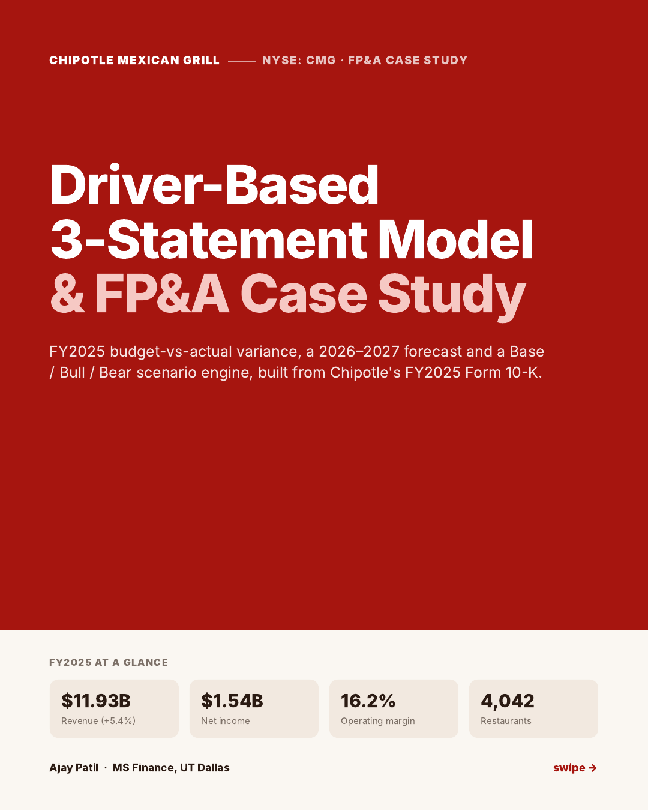
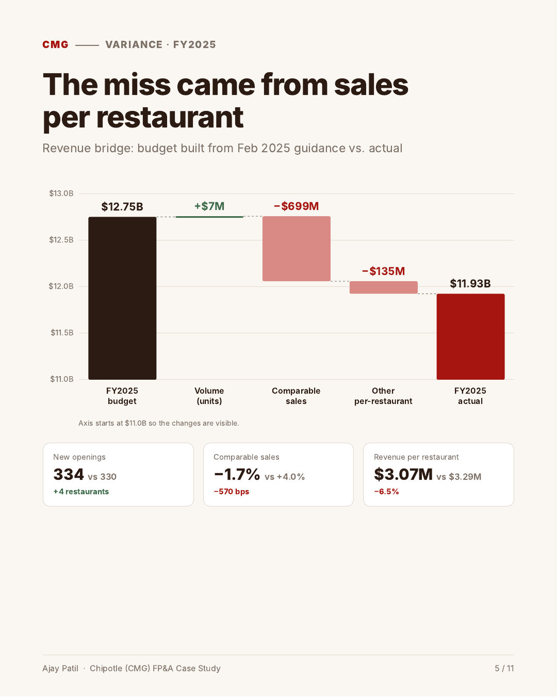
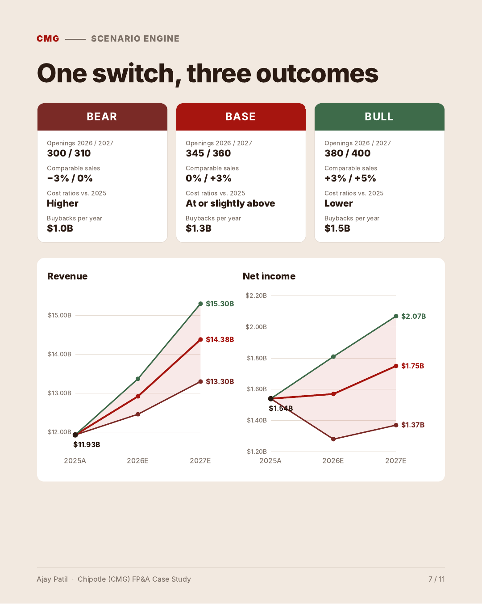

# Chipotle (CMG) Driver-Based 3-Statement Model & FP&A Case Study

**[View the project website →](https://ajaaypatil0108.github.io/chipotle-fpa-model/)**

A fully linked income statement, balance sheet and cash flow model of Chipotle Mexican Grill, built by hand from the FY2025 Form 10-K. It includes a FY2025 budget-vs-actual variance bridge, a 2026–2027 forecast, a one-switch Base / Bull / Bear scenario engine, a Power BI dashboard and a written FP&A memo.

## Key findings

| | |
|---|---|
| **−$828M (−6.5%)** | FY2025 revenue below a budget built from Chipotle's February 2025 guidance |
| **−$699M** | of that gap from comparable sales (−1.7% actual vs. +4.0% budgeted); volume added $7M, other per-restaurant effects cost $135M |
| **16.2%** | Operating margin, only 27 bps below the 16.5% budget |
| **$14.38B** | 2027E revenue in the Base case; net income $1.75B |
| **1.7×** | 2025 buybacks ($2.43B) vs. free cash flow ($1.45B) |

 

## What's in this repository

| File | What it is |
|---|---|
| [`model/Chipotle_3_Statement_Model.xlsx`](model/Chipotle_3_Statement_Model.xlsx) | Excel model: Goal, Historicals, Assumptions (scenario switch), Model, Dashboard data, Variance |
| [`powerbi/Chipotle_FPA_Dashboard.pbix`](powerbi/Chipotle_FPA_Dashboard.pbix) | Power BI dashboard with 8 DAX measures (opens in Power BI Desktop) |
| [`reports/Chipotle_FPA_Case_Study_Ajay_Patil.pdf`](reports/Chipotle_FPA_Case_Study_Ajay_Patil.pdf) | 11-page visual case study |
| [`reports/Chipotle_FPA_Memo.pdf`](reports/Chipotle_FPA_Memo.pdf) | Written FP&A memo: variance review, forecast, assumptions, sensitivities |
| [`docs/`](docs/) | Source of the project website (GitHub Pages) |

## How the model works

1. **Actuals:** FY2023–FY2025 statements and restaurant counts from the FY2025 Form 10-K.
2. **Revenue:** average restaurants × revenue per restaurant, which grows at the comparable-sales rate. Costs are a % of revenue.
3. **Linked statements:** net income, capex, buybacks and working capital flow through an indirect-method cash flow; cash is the balancing item. The balance check is zero in every year and every scenario.
4. **Scenarios:** one cell on the Assumptions tab (1 = Base, 2 = Bull, 3 = Bear) re-runs openings, comparable sales, cost ratios, tax rate and buybacks.
5. **Variance:** the FY2025 bridge splits the revenue miss into volume, comparable-sales and other per-restaurant effects.

Base-case 2026 openings (345), comparable sales (0%) and tax rate (25%) are tied to Chipotle's February 2026 guidance; 2027 drivers, capex, buybacks and cost ratios are my own assumptions. Leases, investments and other long-term items are held at 2025 levels, and EPS is not modeled.

## Sources

- Chipotle Mexican Grill [FY2025 Form 10-K](https://www.sec.gov/Archives/edgar/data/1058090/000105809026000009/cmg-20251231.htm)
- [Q4 and full year 2025 results and 2026 outlook](https://newsroom.chipotle.com/2026-02-03-CHIPOTLE-ANNOUNCES-FOURTH-QUARTER-AND-FULL-YEAR-2025-RESULTS) (Feb 3, 2026)
- [2025 outlook, Form 8-K exhibit 99.1](https://www.sec.gov/Archives/edgar/data/1058090/000105809025000008/cmg-20250204xex991.htm) (Feb 4, 2025)

---

**Ajay Patil** · MS Finance, The University of Texas at Dallas

*Independent analysis of public information for educational purposes; not investment advice and not affiliated with Chipotle.*
